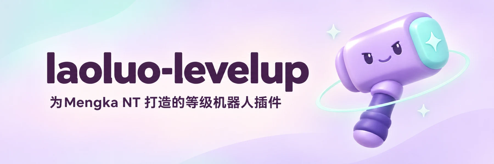

# laoluo-levelup

**为Mengka NT 打造的等级机器人插件。** 通过 Mengka NT 的官方插件机制运行。添加机器人为好友后，私聊发送 **`等级菜单`**，即可登录自己的 QQ、管理等级任务和提交补挂。

**MIT 开源 · 插件免费使用**

[下载插件安装包](https://github.com/laoluo21/laoluo-levelup/releases) · [友情链接：Mengka NT 官方仓库](https://github.com/Carlor-Official/Mengka-NT)

**v0.3.6 简化管理控制台。** 后台入口默认填入当前页面的 HTTPS 域名。托管 Docker 安装可通过 Unix Socket 将控制台接入现有 Mengka 域名的 `/laoluo-levelup/` 路径。 [接入步骤](管理页面访问说明.md#1-用现有-mengka-域名打开管理页) · [更新记录](CHANGELOG.md)

## 功能

- **私聊自助**：好友只能操作自己的 QQ。支持 Pad 登录、按登录结果继续验证，以及 Linux 电脑登录。
- **智能补挂**：刷新任务面板，只提交已开启、受支持且明确未完成的项目，30 秒内防止重复提交。提交后的完成状态以实际任务面板为准。
- **自动补充设备**：新账号优先使用空闲设备，设备不足时通过 Mengka 官方 API 创建指纹。Pad 和 Linux 分别绑定设备，已有账号继续使用原设备。
- **项目管理**：按名称开启或关闭项目，保留框架的定时开关和执行时间。新建账号默认勾选受支持项目。
- **独立管理网页**：配置机器人、协议和免扫偏好，常用设置保存后即可生效。首次使用一次性初始化码设置管理密码。

## 运行要求

| 项目 | 要求 |
| --- | --- |
| Mengka | 以 **Mengka NT 3.2.3** 为适配目标。插件清单最低版本为 3.0.7 |
| 环境 | Linux amd64 或 arm64，官方 IPC 插件导入所需的 Docker 环境已就绪 |
| 机器人 | 使用已经在线的 **NT Pad** 账号，并与使用者互为好友 |
| 框架权益 | 3.2.3 的本人扫码登录与安全验证二维码支持 Plus / Pro，两档均无 QQ 等级前置条件。等级任务及使用在线 Pad 扫码授权仍要求 Plus 对应账号最新等级达到 32 级，Pro 无此等级门槛。Free 无上述接口的调用权限。具体权益由框架核验 |

## 安装与配置

1. 在 [GitHub Releases](https://github.com/laoluo21/laoluo-levelup/releases) 选择与你服务器架构一致的安装包。x86-64 用 `*-linux-amd64.zip`，ARM64 用 `*-linux-arm64.zip`。同一版本提供 `SHA256SUMS`。
2. 在 Mengka 插件管理中导入 ZIP 并启动。打开插件运行日志，查看管理网页的监听地址和一次性初始化码。
3. 用现有 Mengka HTTPS 域名的 `/laoluo-levelup/` 路径打开控制台。托管 Docker 安装可以通过插件 Socket 接入宿主机 Nginx。[管理页面访问说明](管理页面访问说明.md)包含安装包内的接入工具和配置步骤。
4. 在「机器人配置」里选择已在线的 NT Pad 机器人，确认 Pad 和 Linux 协议，然后保存。用户可以添加机器人为好友，在 QQ 私聊发送 `等级菜单`。

「执行设置」里的 Mengka 后台入口在 HTTPS 访问时会自动填入当前域名，并随配置一起保存。已有自定义地址会保留。

升级时保留框架分配的插件持久目录，其中包含配置、网页认证状态和设备归属。建议升级前先备份。

## 私聊指令

| 指令 | 功能 |
| --- | --- |
| `等级菜单` | 查看功能菜单 |
| `开始登录` | 开始本人 QQ 的 Pad 登录 |
| `继续验证` | 在完成当前验证后确认登录状态 |
| `项目开关` | 查看待管理的任务。发送 `完整项目名称 开启` 或 `完整项目名称 关闭` 修改选择 |
| `立即补挂` | 按当前任务状态提交符合条件的项目 |
| `电脑登录` | 开始 Linux 登录，按设置优先尝试免扫，必要时使用当前二维码 |
| `取消操作` | 结束当前插件操作或待完成的验证 |

滑块等需要在 Mengka 后台完成的步骤，以机器人和框架实际提示为准。插件通过官方 API 处理登录，插件自身不持久保存或记录 QQ 密码及短信验证码。QQ 聊天记录和框架保存的账号资料由各自管理。

## 源码构建

需要 **Go 1.23.1 或更新版本**，打包需要 **Python 3**。插件主体、机器人逻辑和网页后端使用 Go，管理页面使用原生 HTML、CSS 和 JavaScript，并随 Go 程序一起编译。

```sh
go test ./...
go vet ./...
python3 scripts/package.py
```

安装包及校验文件输出到 `dist/`。从源码运行测试时，如果本机配置了交叉编译目标，请将 `GOOS` 和 `GOARCH` 临时设为本机平台。

在 Mengka 托管 Docker 部署中已验证 v0.3.5 的同域 HTTPS 管理页。首次设置密码、登录和保存配置已通过独立 Docker + Nginx 测试。3.2.3 的真实好友登录、验证与补挂仍待完整联调。反馈请附插件版本、Mengka 版本、复现步骤和脱敏日志。 [提交 Issue](https://github.com/laoluo21/laoluo-levelup/issues)

## 发布新版本

更新 `internal/levelup/api.go` 中的 `Version`，运行 `python3 scripts/package.py` 更新插件清单，并将版本改动提交到 `main`。为该提交创建匹配的 `v<版本号>` 标签并推送，例如 `v0.3.4`。GitHub Actions 会运行测试并构建 Linux amd64、arm64 安装包及校验文件，全部通过后发布到 Releases。带 `-beta`、`-rc.1` 等后缀的版本会标记为预发行版。

## 许可

本项目按 [MIT License](LICENSE) 开源。第三方依赖许可见 [LICENSES](LICENSES/)。作者：laoluo。
